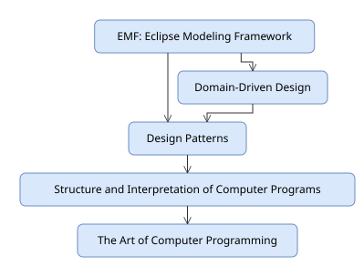

// Default for previewing this file on its own; the Maven build sets examplesdir
ifndef::examplesdir[:examplesdir: ../../../../../examples]

[#diagrams]
== Diagrams

Most diagrams in an organization are drawn once, looked at a few times, and left to drift away from what they describe.
They do not have to be.
A diagram drawn in a tool people already use is a structured document: shapes with names, properties, tooltips and links, joined by connections and nested in containers.
The runtime treats it as one, in both directions: a diagram is a source that models are read from, and a target that models are drawn into.

I once moved a software delivery process of about a hundred activities from a drawing into a diagram editor backed by a model of what is done, by whom, in which phase and with what (<<prior-art>>).
The drawing and the editor showed the same boxes.
Only the editor could say which activities a role performs or what a phase needs, and that difference is what this chapter is about.

This chapter introduces seven modules that do it, and an example that generates a diagram of the library's citations, lays it out, saves it as a Draw.io file, reads it back as a diagram, checks it against the library, and draws it as SVG.

=== A continuum, not a choice

Between a picture and a model there is a continuum.
At one end, a diagram is a picture: boxes and lines that mean something to the people who drew them.
Add names and tooltips, and it is documentation.
Add properties, and programs can read it: a property names the system a shape stands for, its owner, the class of model element it is.
At the far end, a diagram is the source of a model, and the people who own the domain keep it in a tool they already know, while programs check it, generate from it and keep it in step with what it describes.

Each diagram should sit on the continuum where its structure pays for itself, and move right when it needs to.
That is the principle of more structure with less effort applied to pictures (<<principles>>): nobody has to learn a modeling tool to contribute, and nothing has to be redrawn when a diagram starts to matter.

The other direction matters as much.
A model that nobody can see is a private notation (<<web>>), and a diagram generated from a model is the quickest way to show it, provided that it is laid out well enough to read without anyone moving a box.

=== What a good diagram is worth

A diagram is a message, and most of its cost is the reader's time.
An icon for a well-known element, a database, a queue, a person, is recognized before its label is read.
A layout that keeps related things together and lines from crossing is understood in seconds; the same boxes placed at random take minutes, and some readers give up.
Multiplied by every reader and every reading, a good diagram is one of the cheapest efficiencies an enterprise has (<<more-structure>>).

Many people say diagrams are not worth the trouble.
Some of them are the fox in Aesop's fable, who could not reach the grapes and decided they were sour.
Good diagrams have been expensive to draw and more expensive to keep current, so dismissing them was cheaper than making them.
Generated from models and laid out automatically, they are no longer out of reach.

=== Two layers, seven modules

*The Draw.io API and its rendering.*
`drawio` reads, navigates, changes and writes Draw.io documents in plain Java: documents, pages, layers, nodes and connections, properties and placeholders, selectors, links across pages and documents, and styles.
It reads and writes diagrams embedded in PNG images, which is how a figure can be its own source: a reader sees a picture, Draw.io opens the same file for editing, and a program loads it.
`drawio-playwright` renders pages with Draw.io's own viewer in a browser driven by the `playwright` module, in a session that needs no server (<<web>>): PNG and SVG images with the page embedded, pages after a program has clicked their shapes to run custom actions, and videos of pages shown in sequence, each rendering in a span.
It is a module of its own so that `drawio` stays light: Playwright and a browser come only with it.

*The models.*
They form one family, and most of its value comes from the supertypes:

* *The diagram model*, `models/diagram`, has what every notation has: elements with ids, names, documentation and attributes (<<core-model>>); nodes with bounds and ports; connections with waypoints; layers; nesting; and the elements of other models that a shape depicts, its semantic elements.
* *Layout with ELK*, `models/diagram/elk`, places the nodes and routes the connections of any diagram of the model with the Eclipse Layout Kernel: its layered, tree, force and radial algorithms, with options set in code or as attributes of the elements.
* *The presentation model*, `models/presentation` [.sketch]#SKETCH#, extends the diagram model with decks: a presentation is a diagram of slides, and a slide is a diagram of shapes, text, images, tables and connectors.
* *The Draw.io model*, `models/drawio`, extends both: a document is a presentation, a page is a slide, and its layers, nodes and connections are their diagram namesakes. A `.drawio` file, or a PNG or SVG image that Draw.io exported with the diagram in it, loads into any resource set as a model and saves back.
* *The SVG model*, `models/svg`, is a subset of SVG as EMF, with SVG's own namespace, so that a resource of it is an SVG file. It is the vector target for generated diagrams, the same in HTML, PDF and EPUB.

So a program written against the diagram model reads a Draw.io page without knowing it is one, and ELK lays out a Draw.io page because it lays out diagrams.
The example shows both.

=== A diagram generated from a model

The example's diagram shows which books of the library cite which: a node per book that cites or is cited, and a connection per citation.
It is built as a Draw.io model from the start, because a Draw.io page is a diagram, so nothing has to be converted later:

.The citations as a Draw.io document (`diagram/.../Citations.java`)
[source,java]
----
include::{examplesdir}/diagram/src/main/java/org/example/diagram/Citations.java[tag=generate,indent=0]
----
<1> A layout option of ELK, as an attribute of the page. Attributes of elements override the options set in code, so a diagram can carry its own layout preferences.
<2> The documentation of an element is its tooltip in Draw.io.
<3> An attribute that names the book. It is written to the file as a property of the shape, so it survives a round trip through Draw.io, where people can see and change it.
<4> The book the node depicts, as a semantic element: a reference to an object of another model. It lives in memory and is not written to the Draw.io file; the attribute is how the reference is restored after loading.

The nodes have no bounds and the connections no routes.
That is the layout's job:

.Laid out and saved (`diagram/.../TestCitations.java`)
[source,java]
----
include::{examplesdir}/diagram/src/test/java/org/example/diagram/TestCitations.java[tag=layout,indent=0]
----
<1> ELK places the nodes, sizes them to fit their names, routes the connections, and writes bounds and waypoints back into the diagram, in an `ELK Layout` span with the numbers of nodes and edges.
<2> The Draw.io model contributes a resource factory for `.drawio` files to every resource set, so saving a document is saving a resource (<<models>>).

The file opens in Draw.io as a diagram anyone can edit, with the book of each shape among its properties.

=== Read back, and checked

A person rearranges the diagram, adds a citation, or reverses an arrow by mistake.
The program reads the file back and checks it against the library.
The check is written against the diagram model alone, so it works on a Draw.io page, and would work on any notation that maps to the diagram model:

.Mapping nodes to books and checking connections (`diagram/.../Citations.java`)
[source,java]
----
include::{examplesdir}/diagram/src/main/java/org/example/diagram/Citations.java[tag=map,indent=0]
----
<1> A node becomes a depiction of a book again: the attribute names it, and the book becomes the node's semantic element.
<2> A connection between two books must be a citation in the library. The check reports what the diagram shows and the model does not have.

.Reading the file back as a diagram (`diagram/.../TestCitations.java`)
[source,java]
----
include::{examplesdir}/diagram/src/test/java/org/example/diagram/TestCitations.java[tag=check,indent=0]
----
<1> The loaded Draw.io document, used as a `DiagramElement` of the diagram model.
<2> What a person might do in Draw.io: reverse an arrow.
<3> The check names the citation that does not exist.

The direction can also be turned around.
A diagram drawn first, with properties that name classes and features, becomes the source of a model; the Zephyr Book _Diagram Model_ does that with the figure of its own model, drawn in Draw.io, mapped to the metamodel it depicts and checked against it.

=== Drawn as SVG

The same laid-out page draws as SVG through the SVG model.
The drawing is written against the diagram model too, and short, because ELK has done the hard part:

.A diagram drawn as SVG (`diagram/.../SvgDrawing.java`)
[source,java]
----
include::{examplesdir}/diagram/src/main/java/org/example/diagram/SvgDrawing.java[tag=draw,indent=0]
----
<1> Every node has bounds, from ELK: a rounded rectangle with the name in the middle. A label of a connection is a node too, and is not drawn here.
<2> The documentation becomes an SVG `title`, which browsers show as a tooltip.
<3> The waypoints of a connection, from ELK, become a polyline with an arrowhead.

.Saving the drawing (`diagram/.../TestCitations.java`)
[source,java]
----
include::{examplesdir}/diagram/src/test/java/org/example/diagram/TestCitations.java[tag=svg,indent=0]
----
<1> The SVG model contributes a resource factory for `.svg` files, so an SVG drawing is saved, and loaded, like any other model.

// Relative to imagesdir, not through examplesdir: the EPUB converter packs images by a relative path
[#citations-figure]
.The library's citations, generated, laid out with ELK and drawn as SVG by the example

The figure is a copy of the drawing, kept with the example's test resources.
The test loads it back as an SVG model and fails if it no longer shows the books the diagram does, so a figure that no longer matches its example stops the build, like a listing.
Opened on its own in a browser, the SVG file shows each book's year and authors as a tooltip.

=== The Zephyr Books

Each of these modules is documented in depth in a Zephyr Book (<<zephyr-books>>):

* *Draw.io*, for `drawio` and `drawio-playwright`: the visual communication continuum, the API, and rendering with Draw.io's viewer.
* *Draw.io Model*, for `models/drawio`: loading, saving and generating Draw.io documents as models, with a diagram of the running JVM's modules generated, laid out with ELK and rendered by Draw.io's viewer.
* *Diagram Model*, for `models/diagram`: diagrams as data, stored as YAML, converted from Draw.io and mapped to the models they depict.
* *Diagram Layout with ELK*, for `models/diagram/elk`: layout options, diagrams of Ecore models, and rendering with React Flow and Draw.io.
* *SVG Model*, for `models/svg`: SVG as a model, and diagrams laid out with ELK drawn as SVG, every shape a link and every documented shape a tooltip.
* *Presentation Model*, for `models/presentation`: decks, slides, masters, shapes, text, tables, connectors and speaker notes as a model on the diagram model, because a slide is a diagram.

=== What comes next

On the roadmap [.planned]#PLANNED#, as the Zephyr Books describe it:

* *Mapping to models by properties*, as Nasdanika core's semantic mapping does: element properties that name classes and features, so that a diagram loaded into a resource set is a model without code like this chapter's.
* *Merging generated and arranged diagrams*: a diagram generated from a model and arranged by a person, regenerated when the model changes, with the changes merged into the person's layout by id.
* *Custom actions and animations as objects*, so that an animation is generated like a diagram, checked before it renders, and recorded as a video by `drawio-playwright`.
* *Documented diagrams*: a documentation site generated from a diagram, a page per documented element, with the diagram embedded in the viewer and linked to the pages.
* *Executable diagrams*: behavior bound to elements, wired along connections by the capability framework, with telemetry that records what the diagram did, the road to the executable graphs of <<vision>>.
* *Figures from Draw.io files*: an Asciidoctor extension that renders a `.drawio` file referenced from a book as the book is built.

Models for Visio, PowerPoint and Excel are postponed.
